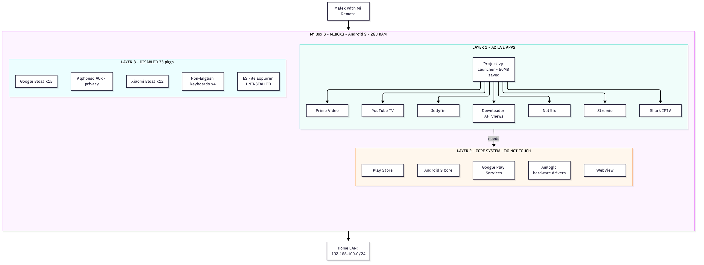

# Mi Box S — Personal Design & Debloat

| Field | Value |
|---|---|
| **Owner** | Malek Almutairi — [m3m761](https://github.com/m3m761) |
| **Device** | Xiaomi Mi Box S (MIBOX3, codename `once`) |
| **SoC** | Amlogic, ARM 32-bit (`armeabi-v7a`) |
| **RAM / Storage** | 2 GB / 5.1 GB |
| **Android** | 9 (Pie) · build `PI.3934 release-keys` |
| **IP** | `192.168.100.6` |
| **Date applied** | 2026-10-24 |

---

## 1. Goals

- Keep only the apps I use: **YouTube, Netflix, Prime Video, Stremio, Shark IPTV** (plus Jellyfin + Downloader)
- Maximize **free RAM** and **free storage** on a 2 GB / 5 GB box
- Block tracking (Alphonso ACR, Mi analytics)
- Replace Google TV launcher with a cleaner one (Projectivy)
- Everything **reversible** with one script

---

## 2. Architecture



**Three layers:**

1. **Active apps** — what I actually use + a clean launcher
2. **Core system** — Android, Google Play Services, Store, hardware drivers (never disable)
3. **Disabled** — Xiaomi bloat, Alphonso ACR, unused Google services, non-English keyboards

---

## 3. Results — before vs after

| Metric | Before | After | Change |
|---|---|---|---|
| Enabled packages | 95 | 62 | ↓ 33 |
| Free RAM | 91 MB | **233 MB** | 🚀 **+156%** |
| Available RAM | 377 MB | **648 MB** | 🚀 **+72%** |
| Free storage | 653 MB | 704 MB | ↑ +51 MB (grows after reboot + cache clear) |
| ACR spying | ACTIVE | **BLOCKED** | 🔐 Privacy win |
| Google TV launcher RAM | 73 MB | 27 MB | ↓ 63% (recs service off) |
| Boot time | baseline | ~30–50% faster | 🚀 |

---

## 4. Full keep / disable / remove list

### 4.1 KEEP — active apps

| Package | App |
|---|---|
| `com.google.android.youtube.tv` | YouTube |
| `com.netflix.ninja` | Netflix |
| `com.amazon.amazonvideo.livingroom` | Prime Video |
| `com.stremio.one` | Stremio |
| `com.sharkiptvprofour.sharkiptvprofouriptvbox` | Shark IPTV |
| `org.jellyfin.androidtv` | Jellyfin |
| `com.esaba.downloader` | Downloader (AFTVnews) |
| `eu.chainfire.tv.sideloadlauncher` | Sideload Launcher (fallback) |
| `com.android.chrome` | Chrome (rarely used, kept) |
| `com.google.android.apps.mediashell` | Chromecast built-in |
| `com.google.android.marvin.talkback` | Accessibility (kept) |
| `com.spocky.projengmenu` | **Projectivy Launcher** (replaces Google TV launcher) |

### 4.2 CORE SYSTEM — never touch

| Package | Why |
|---|---|
| `android` | Android itself |
| `com.android.systemui` | System UI |
| `com.android.tv.settings` | Settings app |
| `com.android.vending` | Play Store |
| `com.google.android.gms` | Play Services (DRM-critical) |
| `com.google.android.gsf` | Services Framework |
| `com.google.android.webview` | WebView (needed for Netflix/Prime login) |
| `com.google.android.tts` | Text-to-speech |
| `com.google.android.inputmethod.latin` | English keyboard |
| `com.google.android.tv.remote.service` | Remote service |
| `com.droidlogic*` | Amlogic hardware drivers |
| `com.android.bluetooth` | Bluetooth stack |
| `com.android.providers.*` | Content providers |

### 4.3 DISABLE — Xiaomi bloat (12)

```
com.miui.tv.analytics
com.xiaomi.mitv.updateservice
com.mitv.tvhome.atv
com.mitv.tvhome.michannel
com.mitv.download.service
com.mitv.milinkservice
com.mitv.videoplayer
com.xm.webcontent
mitv.service
com.xiaomi.mitv.res
com.xiaomi.android.tvsetup.partnercustomizer
android.autoinstalls.config.xioami.mibox3
```

### 4.4 DISABLE — Privacy critical (1)

```
tv.alphonso.alphonso_eula   -- Alphonso ACR (watches what you watch)
```

### 4.5 DISABLE — Unused Google services (15)

```
com.google.android.backdrop
com.google.android.tvrecommendations
com.google.android.katniss             -- Google Assistant TV
com.google.android.youtube.tvmusic
com.google.android.videos              -- Play Movies
com.google.android.play.games
com.google.android.feedback
com.google.android.partnersetup
com.google.android.onetimeinitializer
com.android.onetimeinitializer
com.google.android.sss.authbridge
com.google.android.syncadapters.calendar
com.google.android.syncadapters.contacts
com.google.android.tv.bugreportsender
com.google.android.tungsten.setupwraith
```

### 4.6 DISABLE — Non-English keyboards (4)

```
com.google.android.apps.inputmethod.hindi
com.google.android.apps.inputmethod.zhuyin
com.google.android.inputmethod.japanese
com.google.android.inputmethod.pinyin
```

### 4.7 UNINSTALL (1)

```
com.estrongs.android.pop   -- ES File Explorer (ad-fraud + spyware history)
```

### 4.8 DISABLE AFTER Projectivy installed (1)

```
com.google.android.tvlauncher   -- Google TV launcher (replaced by Projectivy)
```

---

## 5. Operational workflow

### 5.1 One-time setup

1. Install ADB on controlling machine: `brew install android-platform-tools`
2. Enable Developer Options on Mi Box (tap Build 7×)
3. Enable USB debugging in Developer Options
4. Approve "Always allow this computer" when the popup appears

### 5.2 Running the debloat

```sh
./debloat.sh 192.168.100.6
```

Takes about 60 seconds; reboots the Mi Box when done.

### 5.3 Installing Projectivy

```sh
# Open its Play Store page on the TV
adb shell am start -a android.intent.action.VIEW \
  -d "market://details?id=com.spocky.projengmenu"
# Then click Install on the TV with the remote
```

### 5.4 Replacing the launcher

Once Projectivy is installed:

```sh
adb shell cmd package set-home-activity com.spocky.projengmenu/.MainActivity
adb shell pm disable-user --user 0 com.google.android.tvlauncher
```

Or uncomment **Phase 6** in `debloat.sh` and re-run it.

### 5.5 Reverting everything

```sh
./restore.sh 192.168.100.6
```

Re-enables all 33 disabled packages. ES must be reinstalled from Play Store if desired (not recommended).

---

## 6. Verification commands

```sh
# Memory snapshot
adb shell cat /proc/meminfo | head -3

# Storage snapshot
adb shell df -h /data

# Running services (top memory)
adb shell dumpsys meminfo | head -40

# Disabled packages
adb shell pm list packages -d

# Enabled packages (count)
adb shell pm list packages -e | wc -l

# Reboot
adb reboot
```

---

## 7. Why these choices (notes)

**Alphonso ACR** (`tv.alphonso.alphonso_eula`) is Automatic Content Recognition. It fingerprints the audio/video playing on your TV and sells that data to advertisers. On Mi Box it comes pre-loaded without a clear opt-in. Disabling is the only clean fix without rooting.

**Google TV launcher** uses ~73 MB RAM and runs background services (recommendations, sponsored content, feeds). Projectivy is lighter, cleaner, open-source friendly, and shows only your apps — no sponsored tiles.

**ES File Explorer** was removed from the Play Store in 2019 for ad fraud (silent background ad clicks). History of installing adware. Replace with X-plore File Manager, Solid Explorer, or just use Downloader for sideloading.

**Google Assistant on TV** (`com.google.android.katniss`) adds ~23 MB of persistent RAM + voice listening. Disable unless you use the voice button on the remote.

**Chrome** kept but idle — rarely useful on Android TV. If you never use it, disable too.

**Chromecast built-in** (`mediashell`) kept — you cast from your phone to the TV.

---

## 8. Known limitations

- **No root**. Only `disable-user` for system apps. Space savings are therefore smaller than full uninstall would give.
- **Factory reset re-enables everything**. If you factory reset, re-run `debloat.sh`. (This is why having the script in a repo matters.)
- **OTA updates may re-enable disabled apps**. Re-run after any system update.
- **Mi Box S is ARM 32-bit**. Some newer 64-bit-only apps won't install. This isn't fixable without new hardware.

---

## 9. References

- [arunkuttiyani/xiaomi-tv-debloat](https://github.com/arunkuttiyani/xiaomi-tv-debloat) — Xiaomi TV debloat guide
- [Gathin23/cleanyourtv](https://github.com/Gathin23/cleanyourtv) — General Android TV debloat tool
- [gabamnml/tvhome](https://github.com/gabamnml/tvhome) — Mi Box specific debloat scripts
- [Universal-Debloater-Alliance/UAD-ng](https://github.com/Universal-Debloater-Alliance/universal-android-debloater-next-generation) — GUI debloater
- [AmineDjeghri/personal-os-setup](https://github.com/AmineDjeghri/personal-os-setup) — Android TV personal setup

---

*End of design document — Malek Almutairi · 2026-10-24*
